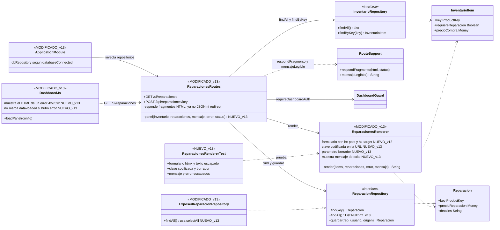
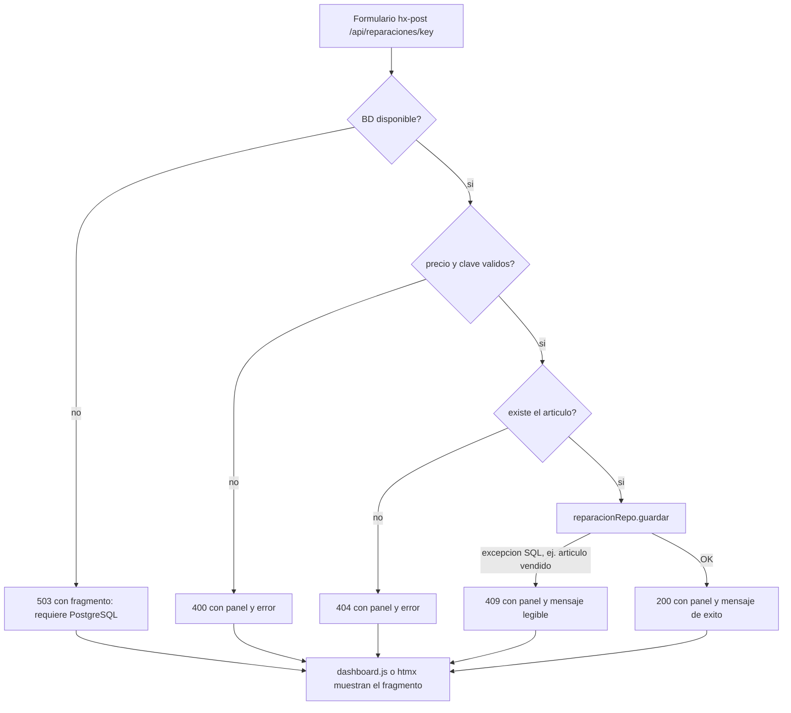

# Diagrama de clases v13 — Tabla de reparaciones del dashboard (completo)

Muestra las clases que **cambian en v13** (marcadas `MODIFICADO_v13` / `NUEVO_v13`) y con quién se relacionan.
El diagrama anterior es `DIAGRAMA_DE_CLASES_v9.md` (v10, v11 y v12 no actualizaron diagrama; lo de v12 sobre `ConfirmPaymentUseCase`, `Money` y `ProductKey` sigue vigente tal como está en v9).
Se visualiza en GitHub, VS Code (extensión Mermaid) o en https://mermaid.live

## Flujo de guardar una reparación en v13

