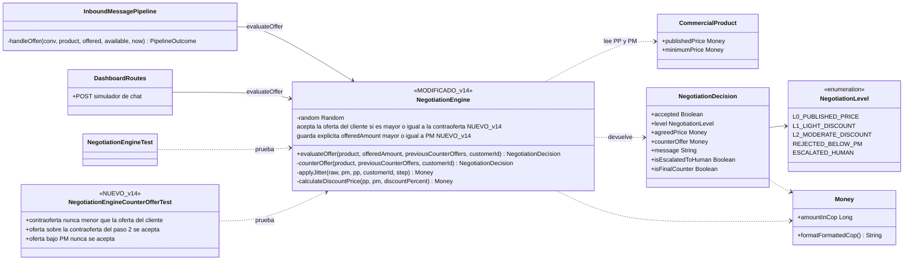
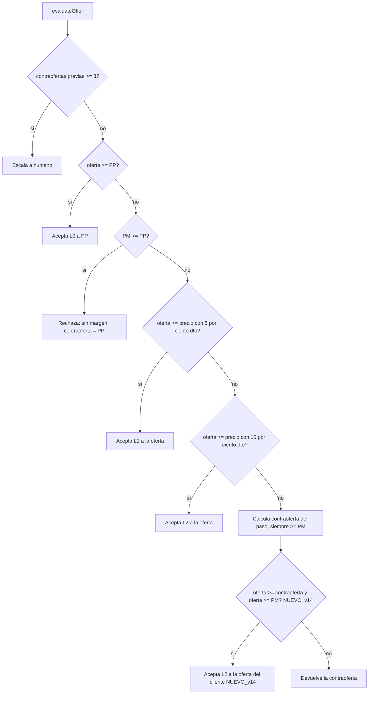

# Diagrama de clases v14 — Motor de negociación

Muestra las clases que **cambian en v14** (`MODIFICADO_v14` / `NUEVO_v14`) y con quién se relacionan.
El diagrama anterior es `DIAGRAMA_DE_CLASES_v13.md` (tabla de reparaciones del dashboard); lo que v14 no menciona sigue
vigente tal como está allí. v14 no modifica `InboundMessagePipeline`, `DashboardRoutes` ni el modelo de datos.
Se visualiza en GitHub, VS Code (extensión Mermaid) o en https://mermaid.live

## Flujo de `evaluateOffer` en v14

