# Diagrama de clases — Tienda Virtual Multicanal, Semiautogestionada (v4)

Lo **nuevo de esta entrega (v4)** está marcado con `<<NUEVO_v4>>`; lo modificado en v4 con `<<MODIFICADO_v4>>`.
Lo que venía de v1–v3 aparece sin marca especial (las marcas `<<NUEVO_v2>>`/`<<NUEVO_v3>>` se conservan solo como referencia histórica).
Se visualiza en GitHub, VS Code (extensión Mermaid) o en https://mermaid.live

```mermaid
classDiagram
    direction LR

    %% ---------- shared-kernel ----------
    class PortResult~T~ {
        <<sealed interface>>
    }
    class ProductKey { +String value }
    class Money { +Long amountInCop }
    class DomainEvent {
        <<sealed interface>>
    }

    %% ---------- commerce ----------
    class CommercialProduct
    class InventarioItem
    class OperationalInventory {
        +recordSale(qty) OperationalInventory
        +stockVivo Int
    }
    class Reservation
    class Venta
    class PublicProductDto
    class NegotiationEngine
    class ChannelPricingService
    class AntiOversellSaga {
        +executeRetractionSaga()
    }
    class CatalogPublishingPort {
        <<interface>>
        +publishProduct()
        +updateProduct()
        +setStock()
        +unpublishProduct()
        +getStatus()
    }
    class InventarioRepository { <<interface>> }
    class VentaRepository { <<interface>> }
    class ReparacionRepository { <<interface>> }
    class HistorialRepository { <<interface>> }

    %% ---------- messaging ----------
    class MessagingPort {
        <<interface>>
        +channelName String
        +sendMessage()
        +sendProductCard()
    }
    class LlmPort {
        <<interface>>
        +parseIntent()
    }
    class Conversation {
        <<MODIFICADO_v3>>
        +agreedPriceCop Long?
    }
    class Message
    class ChannelRouter {
        <<NUEVO_v2>>
        +supports(channel) Boolean
        +sendMessage(channel, recipientId, text) PortResult
        +sendProductCard(channel, ...) PortResult
    }
    class ProcessedEventStore {
        <<interface>>
                +markIfNew(channel, externalEventId) Boolean
    }
    class InMemoryProcessedEventStore {
                -maxEntries Int
        +markIfNew(channel, externalEventId) Boolean
    }

    class ConversationStore {
        <<NUEVO_v3 interface>>
        +find(channel, customerId) Conversation?
        +findById(id) Conversation?
        +save(conversation)
        +all() List
    }
    class InMemoryConversationStore {
        <<NUEVO_v3>>
    }

    %% ---------- adaptadores ----------
    class ShopifyCatalogAdapter
    class ShopifyWebhookHandler
    class MetaShopAdapter {
        placeholder: no llama a Meta aún
    }
    class MetaMessagingAdapter {
                -apiVersion String  (ya sin valor por defecto)
    }
    class WhatsAppMessagingAdapter {
                -apiVersion String  (ya sin valor por defecto)
    }
    class MetaWebhookReceiver {
                +verifyWebhookChallenge()
        +parseInboundPayload()
        canal según campo object
        descarta eventos sin id
    }
    class GeminiLlmAdapter {
        <<MODIFICADO_v4>>
        lee 110000, 110.000, 110,000, 110 mil y 110k
    }

    %% ---------- infra ----------
    class AppConfig {
                +metaGraphApiVersion String
        <<MODIFICADO_v4>>
        +dashboardUser String
        +dashboardPassword String
    }
    class DatabaseFactory
    class ExposedProcessedEventStore {
        <<NUEVO_v2>>
        -fallback ProcessedEventStore
        +markIfNew(channel, externalEventId) Boolean
    }
    class EventosProcesadosTable {
        <<NUEVO_v2>>
        tienda.eventos_procesados
    }
    class ExposedInventarioRepository
    class ExposedVentaRepository
    class ExposedReparacionRepository
    class ExposedHistorialRepository

    %% ---------- app ----------
    class AppStore {
                +databaseConnected Boolean
        +refreshIntegrationStatuses()
        +seedSampleData()
    }
    class PipelineCatalog {
        <<NUEVO_v3 interface>>
        +productKeys() List
        +product(key) CommercialProduct?
        +inventory(key) OperationalInventory?
        +saveInventory(inventory)
    }
    class AppStoreCatalog {
        <<NUEVO_v3>>
        acceso sincronizado a AppStore
    }
    class InboundMessagePipeline {
        <<NUEVO_v3 / MODIFICADO_v4>>
        ignora cifras absurdas (> 10x el precio publicado)
        +handle(channel, senderId, messageId, text) PipelineOutcome
        +sweep() libera reservas vencidas
        +activeReservationCount() Int
        escala a humano ante comprobante de pago
    }
    class PipelineOutcome {
        <<NUEVO_v3>>
        +conversation
        +reply String?
        +dealLabel String
    }
    class ApiIntegrationStatus
    class ChatDealLog
    class DashboardRenderer {
        <<MODIFICADO_v4>>
        escapa todo dato que viene de clientes
    }
    class DashboardAuth {
        <<NUEVO_v4>>
        +enabled Boolean
        +isAuthorized(authorizationHeader) Boolean
    }
    class Application {
                POST /webhooks/meta  (idempotente)
        POST /webhooks/shopify  (idempotente)
    }

    %% ---------- relaciones ----------
    ShopifyCatalogAdapter ..|> CatalogPublishingPort
    MetaShopAdapter ..|> CatalogPublishingPort
    AntiOversellSaga --> CatalogPublishingPort
    WhatsAppMessagingAdapter ..|> MessagingPort
    MetaMessagingAdapter ..|> MessagingPort
    GeminiLlmAdapter ..|> LlmPort
    InMemoryProcessedEventStore ..|> ProcessedEventStore
    ExposedProcessedEventStore ..|> ProcessedEventStore
    ExposedProcessedEventStore --> EventosProcesadosTable
    ExposedProcessedEventStore --> InMemoryProcessedEventStore : respaldo si la BD falla
    ChannelRouter --> MessagingPort
    Application --> ChannelRouter
    InMemoryConversationStore ..|> ConversationStore
    AppStoreCatalog ..|> PipelineCatalog
    AppStoreCatalog --> AppStore
    InboundMessagePipeline --> LlmPort
    InboundMessagePipeline --> NegotiationEngine
    InboundMessagePipeline --> PipelineCatalog
    InboundMessagePipeline --> ConversationStore
    InboundMessagePipeline --> ChannelRouter
    InboundMessagePipeline --> Reservation
    InboundMessagePipeline ..> PipelineOutcome : devuelve
    Application --> InboundMessagePipeline : POST /webhooks/meta (en segundo plano)
    ExposedInventarioRepository ..|> InventarioRepository
    ExposedVentaRepository ..|> VentaRepository
    ExposedReparacionRepository ..|> ReparacionRepository
    ExposedHistorialRepository ..|> HistorialRepository

    Application --> AppStore
    Application --> MetaWebhookReceiver
    Application --> ShopifyWebhookHandler
    Application --> ProcessedEventStore
    Application --> AntiOversellSaga
    Application --> NegotiationEngine
    Application --> AppConfig
    Application --> DashboardRenderer
    Application --> DashboardAuth : protege / y /api/*
    DashboardAuth --> AppConfig : DASHBOARD_USER / DASHBOARD_PASSWORD
    AppStore --> ApiIntegrationStatus
    AppStore --> ChatDealLog
    AppStore --> AppConfig
    AppStore --> CommercialProduct
    AppStore --> OperationalInventory
    Application --> WhatsAppMessagingAdapter : apiVersion desde AppConfig
    Application --> MetaMessagingAdapter : apiVersion desde AppConfig
    AppConfig ..> DatabaseFactory : credenciales
    Conversation "1" o-- "*" Message
    CommercialProduct ..> PublicProductDto : toPublicDto()
```

