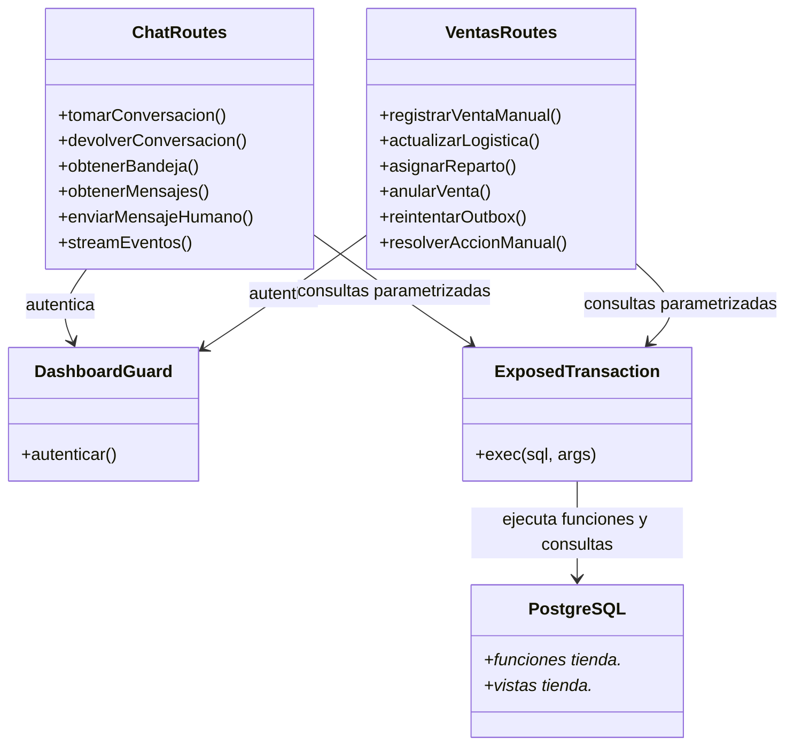

# Diagrama de clases — v6 (cambios de esta entrega)

Este diagrama muestra los módulos tocados y sus relaciones relevantes. No pretende representar todavía las funcionalidades pendientes de las fases 2–6.

## Cambios representados
- `ChatRoutes` y `VentasRoutes` siguen siendo las rutas HTTP del dashboard.
- Los valores variables de SQL se pasan como argumentos de Exposed, no concatenados al texto SQL.
- `DashboardGuard` sigue autenticando una credencial compartida; la identidad individual del operador aún no está implementada.
