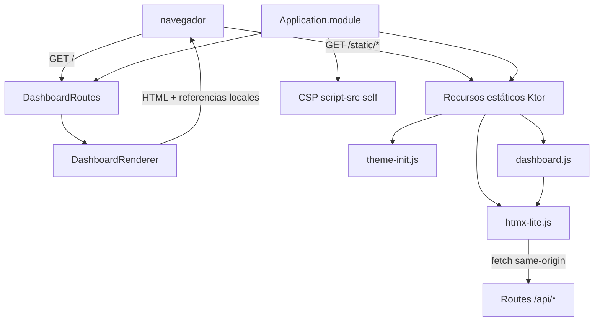

# Diagrama de clases v7 — Fase 2

## Responsabilidades

- `Application.module`: cabeceras de seguridad y publicación de recursos estáticos.
- `DashboardRoutes`: autentica la entrada al dashboard y entrega HTML.
- `DashboardRenderer`: genera el esqueleto HTML y referencia los recursos locales.
- `theme-init.js`: selecciona el tema antes de renderizar la página.
- `dashboard.js`: comportamiento de interfaz ya existente separado del HTML.
- `htmx-lite.js`: realiza solicitudes GET/POST y actualiza el destino indicado; implementa solo el subconjunto requerido actualmente.

Este diagrama describe la base de interfaz de la Fase 2. No implica que las pestañas de Socios, Inventario, Reparaciones, Ventas o Sincronización ya estén integradas.
