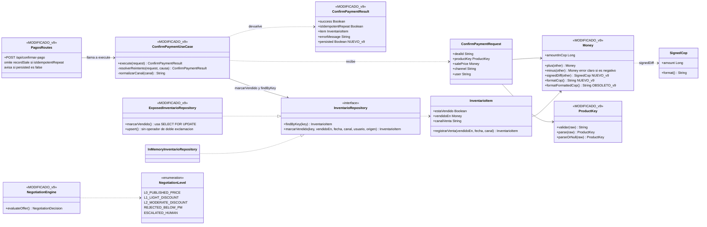
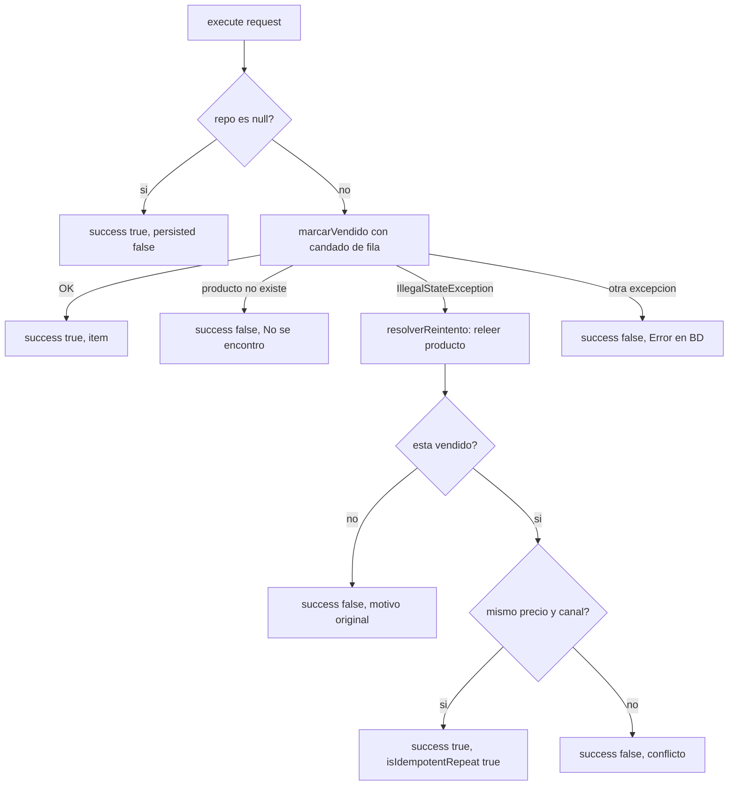

# Diagrama de clases v9 — Pago idempotente, resultado sin BD y ajustes de `Money`

Muestra las clases que **cambian en v9** (marcadas `NUEVO_v9` / `MODIFICADO_v9`) y con quién se relacionan.
El diagrama completo de base sigue siendo `DIAGRAMA_DE_CLASES_v4.md` más los cambios de v6, v7 y v8.
Se visualiza en GitHub, VS Code (extensión Mermaid) o en https://mermaid.live

## Flujo de `execute` en v9

