# Diagrama de clases — Tienda Virtual Multicanal, Semiautogestionada (v5 · Fase 1: seguridad)

Lo **nuevo de la Fase 1** está marcado con `<<NUEVO_F1>>`; lo modificado en la Fase 1 con `<<MODIFICADO_F1>>`.
Lo que venía de v1–v4 aparece sin marca especial (las marcas `<<NUEVO_v2>>`, `<<NUEVO_v3>>`, `<<NUEVO_v4>>`, `<<MODIFICADO_v4>>`
se conservan solo en las clases que la Fase 1 no tocó, como referencia histórica). Este archivo reemplaza a `DIAGRAMA_DE_CLASES_v4.md`
(que se deja intacto).
Se visualiza en GitHub, VS Code (extensión Mermaid) o en https://mermaid.live

```mermaid
classDiagram
    direction LR

    %% ---------- shared-kernel ----------
    class PortResult~T~ {
        <<sealed interface>>
    }
    class ProductKey { +String value }
    class Money { +Long amountInCop }
    class DomainEvent {
        <<sealed interface>>
    }

    %% ---------- commerce ----------
    class CommercialProduct
    class InventarioItem
    class OperationalInventory {
        +recordSale(qty) OperationalInventory
        +stockVivo Int
    }
    class Reservation
    class Venta
    class PublicProductDto
    class NegotiationEngine
    class ChannelPricingService
    class AntiOversellSaga {
        +executeRetractionSaga()
    }
    class CatalogPublishingPort {
        <<interface>>
        +publishProduct()
        +updateProduct()
        +setStock()
        +unpublishProduct()
        +getStatus()
    }
    class InventarioRepository { <<interface>> }
    class VentaRepository { <<interface>> }
    class ReparacionRepository { <<interface>> }
    class HistorialRepository { <<interface>> }

    %% ---------- messaging ----------
    class MessagingPort {
        <<interface>>
        +channelName String
        +sendMessage()
        +sendProductCard()
    }
    class LlmPort {
        <<interface>>
        +parseIntent()
    }
    class Conversation {
        <<MODIFICADO_v3>>
        +agreedPriceCop Long?
    }
    class Message
    class ChannelRouter {
        <<NUEVO_v2>>
        +supports(channel) Boolean
        +sendMessage(channel, recipientId, text) PortResult
        +sendProductCard(channel, ...) PortResult
    }
    class ProcessedEventStore {
        <<interface>>
                +markIfNew(channel, externalEventId) Boolean
    }
    class InMemoryProcessedEventStore {
                -maxEntries Int
        +markIfNew(channel, externalEventId) Boolean
    }

    class ConversationStore {
        <<NUEVO_v3 interface>>
        +find(channel, customerId) Conversation?
        +findById(id) Conversation?
        +save(conversation)
        +all() List
    }
    class InMemoryConversationStore {
        <<NUEVO_v3>>
    }

    %% ---------- adaptadores ----------
    class ShopifyCatalogAdapter
    class ShopifyWebhookHandler
    class MetaShopAdapter {
        placeholder: no llama a Meta aún
    }
    class MetaMessagingAdapter {
                -apiVersion String  (ya sin valor por defecto)
    }
    class WhatsAppMessagingAdapter {
                -apiVersion String  (ya sin valor por defecto)
    }
    class MetaWebhookReceiver {
        <<MODIFICADO_F1>>
        +verifyWebhookChallenge() rechaza token vacio
        +authenticate(rawBody, header, appSecret) SignatureResult
        +verifySignature() HMAC SHA-256
        +parseInboundPayload()
        canal según campo object
        descarta eventos sin id
    }
    class SignatureResult {
        <<NUEVO_F1 enum>>
        VALID
        SECRET_NOT_CONFIGURED
        INVALID
    }
    class GeminiLlmAdapter {
        <<MODIFICADO_v4>>
        lee 110000, 110.000, 110,000, 110 mil y 110k
    }

    %% ---------- infra ----------
    class AppConfig {
        <<MODIFICADO_F1>>
        +metaGraphApiVersion String
        +dashboardUser String
        +dashboardPassword String
        +appEnv AppEnv
        +trustProxyHeaders Boolean
        +corsAllowedHost String
        +get(key, default) String  ignora placeholders
        +hasPlaceholder(key) Boolean
        requireMetaSignature ELIMINADO
    }
    class AppEnv {
        <<NUEVO_F1 enum>>
        LOCAL
        PRODUCTION
        +parse(raw) AppEnv
    }
    class ConfigPlaceholders {
        <<NUEVO_F1>>
        +isPlaceholder(value) Boolean
    }
    class DatabaseFactory
    class ExposedProcessedEventStore {
        <<NUEVO_v2>>
        -fallback ProcessedEventStore
        +markIfNew(channel, externalEventId) Boolean
    }
    class EventosProcesadosTable {
        <<NUEVO_v2>>
        tienda.eventos_procesados
    }
    class ExposedInventarioRepository
    class ExposedVentaRepository
    class ExposedReparacionRepository
    class ExposedHistorialRepository

    %% ---------- app ----------
    class AppStore {
                +databaseConnected Boolean
        +refreshIntegrationStatuses()
        +seedSampleData()
    }
    class PipelineCatalog {
        <<NUEVO_v3 interface>>
        +productKeys() List
        +product(key) CommercialProduct?
        +inventory(key) OperationalInventory?
        +saveInventory(inventory)
    }
    class AppStoreCatalog {
        <<NUEVO_v3>>
        acceso sincronizado a AppStore
    }
    class InboundMessagePipeline {
        <<NUEVO_v3 / MODIFICADO_v4>>
        ignora cifras absurdas (> 10x el precio publicado)
        +handle(channel, senderId, messageId, text) PipelineOutcome
        +sweep() libera reservas vencidas
        +activeReservationCount() Int
        escala a humano ante comprobante de pago
    }
    class PipelineOutcome {
        <<NUEVO_v3>>
        +conversation
        +reply String?
        +dealLabel String
    }
    class ApiIntegrationStatus
    class ChatDealLog
    class DashboardRenderer {
        <<MODIFICADO_v4>>
        escapa todo dato que viene de clientes
    }
    class DashboardAuth {
        <<NUEVO_v4>>
        +enabled Boolean
        +isAuthorized(authorizationHeader) Boolean
    }
    class DashboardSecurity {
        <<NUEVO_F1>>
        +MIN_PASSWORD_LENGTH Int
        +plan(env, user, password) DashboardSecurityPlan
        lanza IllegalStateException en production sin clave
    }
    class DashboardSecurityPlan {
        <<NUEVO_F1>>
        +host String
        +auth DashboardAuth
        +warnings List
    }
    class AuthThrottle {
        <<NUEVO_F1>>
        +retryAfterSeconds(client) Long
        +recordFailure(client)
        5 fallos en 5 min, espera 1 min x2 hasta 1 h
        memoria acotada a 10000 clientes
    }
    class OriginGuard {
        <<NUEVO_F1>>
        +isSameOrigin(origin, referer, host) Boolean
        defensa CSRF minima
    }
    class DashboardGuard {
        <<NUEVO_F1 privada en Application.kt>>
        +auth DashboardAuth
        +throttle AuthThrottle
        +trustProxy Boolean
    }
    class Application {
        <<MODIFICADO_F1>>
        main() valida seguridad antes de abrir el puerto
        host 127.0.0.1 en local / 0.0.0.0 en production
        CORS solo si hay CORS_ALLOWED_HOST
        requireDashboardAuth(guard, mutating)
        POST /webhooks/meta  (firma obligatoria, idempotente)
        POST /webhooks/shopify  (idempotente)
    }

    %% ---------- relaciones ----------
    ShopifyCatalogAdapter ..|> CatalogPublishingPort
    MetaShopAdapter ..|> CatalogPublishingPort
    AntiOversellSaga --> CatalogPublishingPort
    WhatsAppMessagingAdapter ..|> MessagingPort
    MetaMessagingAdapter ..|> MessagingPort
    GeminiLlmAdapter ..|> LlmPort
    InMemoryProcessedEventStore ..|> ProcessedEventStore
    ExposedProcessedEventStore ..|> ProcessedEventStore
    ExposedProcessedEventStore --> EventosProcesadosTable
    ExposedProcessedEventStore --> InMemoryProcessedEventStore : respaldo si la BD falla
    ChannelRouter --> MessagingPort
    Application --> ChannelRouter
    InMemoryConversationStore ..|> ConversationStore
    AppStoreCatalog ..|> PipelineCatalog
    AppStoreCatalog --> AppStore
    InboundMessagePipeline --> LlmPort
    InboundMessagePipeline --> NegotiationEngine
    InboundMessagePipeline --> PipelineCatalog
    InboundMessagePipeline --> ConversationStore
    InboundMessagePipeline --> ChannelRouter
    InboundMessagePipeline --> Reservation
    InboundMessagePipeline ..> PipelineOutcome : devuelve
    Application --> InboundMessagePipeline : POST /webhooks/meta (en segundo plano)
    ExposedInventarioRepository ..|> InventarioRepository
    ExposedVentaRepository ..|> VentaRepository
    ExposedReparacionRepository ..|> ReparacionRepository
    ExposedHistorialRepository ..|> HistorialRepository

    Application --> AppStore
    Application --> MetaWebhookReceiver
    Application --> ShopifyWebhookHandler
    Application --> ProcessedEventStore
    Application --> AntiOversellSaga
    Application --> NegotiationEngine
    Application --> AppConfig
    Application --> DashboardRenderer
    Application --> DashboardGuard : protege / y /api/*
    DashboardGuard --> DashboardAuth : credenciales Basic
    DashboardGuard --> AuthThrottle : 429 tras 5 fallos
    DashboardGuard ..> OriginGuard : 403 si el POST viene de otro origen
    Application --> DashboardSecurity : valida al arrancar
    DashboardSecurity --> DashboardSecurityPlan : devuelve
    DashboardSecurityPlan --> DashboardAuth
    DashboardSecurity ..> AppEnv
    AppConfig --> AppEnv : APP_ENV
    AppConfig --> ConfigPlaceholders : descarta valores de ejemplo
    DashboardSecurity --> AppConfig : DASHBOARD_USER / DASHBOARD_PASSWORD
    MetaWebhookReceiver ..> SignatureResult : devuelve
    AppStore --> ApiIntegrationStatus
    AppStore --> ChatDealLog
    AppStore --> AppConfig
    AppStore --> CommercialProduct
    AppStore --> OperationalInventory
    Application --> WhatsAppMessagingAdapter : apiVersion desde AppConfig
    Application --> MetaMessagingAdapter : apiVersion desde AppConfig
    AppConfig ..> DatabaseFactory : credenciales
    Conversation "1" o-- "*" Message
    CommercialProduct ..> PublicProductDto : toPublicDto()
```

