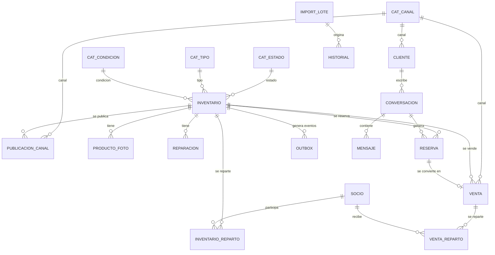

# Plan de Implementación — Actualización v5 (revisión 2)

> **Reemplaza** a `PLAN_DE_IMPLEMENTACION_v5.md`.
> Incorpora tres requisitos nuevos:
> 1. **Supabase es la base principal.** El Excel es solo una vía para alimentarla.
> 2. **Todas las tablas se ven desde el dashboard.**
> 3. **Tablas normalizadas, conectadas, y que se actualicen en conjunto.**

**Limitaciones de la auditoría.** El código se revisó leyendo los fuentes; no se compiló ni se ejecutó contra Supabase. Hay dos cosas que no pude ver y que la Fase 0 verifica:
- El esquema **real** de tu Supabase puede diferir del que dejan los scripts del repo.
- No revisé a fondo `V004__sync_columnas_inventario.sql`.

---

## 1. Qué cambia respecto al plan anterior

### Hallazgos nuevos (confirmados leyendo el código)

| # | Hallazgo | Evidencia | Consecuencia |
|---|---|---|---|
| H1 | **La fuente de verdad está invertida.** El dashboard, el bot y el simulador leen de memoria (`AppStore`). La BD se carga una sola vez al arrancar y el upload escribe primero en memoria y después en la BD «si se puede». | `Application.kt`: `get("/")`, `AppStoreCatalog`, bloque de upload | Si editas algo directo en Supabase, el sistema no lo ve hasta reiniciar. Si el guardado en BD falla, la memoria igual queda cambiada. |
| H2 | **El precio mínimo del bot puede ser distinto al de Supabase.** | El upload guarda en memoria el PM y el costo que vienen del Excel. La BD ignora ese PM y lo calcula con un trigger sobre `costo_total` (compra + reparación). | Antes de un reinicio el bot negocia con un PM; después, con otro. |
| H3 | **Importar puede borrar datos de Supabase.** | El upload reconstruye un `InventarioItem` desde `CommercialProduct`, que no tiene `link`, fechas, `requiere_reparacion` ni reparto entre socios. `escribir()` reescribe **todas** las columnas con esos valores por defecto. | Cada importación puede pisar con vacíos columnas que el Excel ni siquiera trae. Debe confirmarse en staging con un import de prueba. |
| H4 | **El Excel exportado no tiene todas las columnas.** | `ExcelGenerator` no exporta fecha de publicación, «vendido en», canal, % de socios ni «requiere reparación». | Exportar y volver a importar pierde información (agrava H3). |
| H5 | **Hay tres esquemas solapados para lo mismo.** | `tienda.*` (el real, con triggers); `com_*`/`msg_*` en `PostgresTables.kt` (ninguna clase los usa); `conversaciones`, `reservas`, `ventas`, `outbox` en `V002`/`V003`, sin esquema. | Hay **dos tablas `ventas`** con significados distintos. `V001`/`V002` apuntan a `inventario` sin `tienda.`. |
| H6 | **Varios datos no están normalizados.** | Detalles en la sección 4. | Datos que pueden quedar incoherentes entre sí. |
| H7 | **Tablas que existen pero la app no usa.** | `ExposedVentaRepository`, `ExposedReparacionRepository` y `ExposedHistorialRepository` no se invocan desde `app`. | Ventas, métricas e historial no se ven en ningún lado. |
| H8 | **La hoja «Publicación»/«Canales» se lee pero no se guarda.** | El upload solo usa `parseResult.products`. | Los precios por canal del Excel se descartan. |
| H9 | **`tienda.ventas` solo permite una venta por producto** (PK = `key`) aunque `inventario.cantidad` admite varias unidades. | `migracion_fase2.sql` | Un ítem con 5 unidades solo puede venderse como «todo o nada». |

### Mapa de fases: antes → ahora

| Plan anterior | Plan nuevo | Cambio |
|---|---|---|
| Fase 0 | **Fase 0** | + auditoría del esquema real |
| Fase 1 | **Fase 1** | + hotfix mínimo del pago confirmado |
| Fase 2 (ciclo de venta) | **Fase 4** | Se hace sobre el modelo normalizado |
| Fase 3 (persistencia) | **Fase 3** | Se rehace: la BD pasa a ser la fuente de verdad; el stock se **calcula**, no se guarda en contadores |
| — | **Fase 2** *(nueva)* | Modelo de datos normalizado |
| — | **Fase 5** *(nueva)* | Importador Excel → Supabase |
| — | **Fase 6** *(nueva)* | Visor de todas las tablas en el dashboard |
| Fases 4, 5, 6, 7, 8, 9 | Fases 7, 8, 9, 10, 11, 12 | Renumeradas; la 8 suma controles del visor |

---

## 2. Principios de ejecución

1. **Supabase manda.** Ningún dato de negocio vive solo en memoria. La memoria es, como máximo, una caché de lectura de vida corta.
2. **El Excel nunca borra.** Importar actualiza solo lo que el archivo trae y nunca toca ventas, reservas ni conversaciones.
3. **Un solo camino de escritura.** Las operaciones de negocio (reservar, vender, confirmar pago) son funciones SQL atómicas o transacciones únicas. Nada escribe tablas operativas «a mano».
4. **Nada derivado se guarda duplicado.** Lo que se puede calcular (stock, métricas) se calcula.
5. **Expandir → migrar → contraer.** Los cambios de esquema se hacen en tres pasos para no romper la app en producción.
6. **Mínimo cambio necesario por entrega**, con archivos completos, `MANUAL_DE_CAMBIOS_vX.md` (partes exactas y porqué) y `DIAGRAMA_DE_CLASES_vX.md` aparte.
7. **Test antes que arreglo.** El dominio decide precios y stock; el LLM solo interpreta texto.

---

## 3. Resumen y orden de las fases

| Fase | Objetivo | Prioridad | Esfuerzo | Depende de |
|---|---|---|---|---|
| 0 | Línea base, auditoría del esquema real, decisiones | Previa | 1–1,5 d | — |
| 1 | Contraofertas, simulador y hotfix del pago | Crítica | 2–2,5 d | 0 |
| 2 | **Modelo de datos normalizado** | Crítica | 5–7 d | 0 |
| 3 | **Supabase como fuente de verdad** y estado operacional persistente | Crítica | 4–6 d | 2 |
| 4 | Ciclo de venta completo (pago → venta) | Crítica | 2–3 d | 3 |
| 5 | **Importador Excel → Supabase** | Alta | 3–4 d | 3 |
| 6 | **Visor de todas las tablas** en el dashboard | Alta | 3–4 d | 2, 3 |
| 7 | Concurrencia, idempotencia y límites | Alta | 2–3 d | 3 |
| 8 | Endurecimiento web, PM y rol de solo lectura | Alta | 3–4 d | 0 (parte 6) |
| 9 | Sincronización real de canales | Media | 4–6 d | 3, 7 |
| 10 | Optimización y observabilidad | Media | 2 d | 3 |
| 11 | Higiene del repo y export Excel | Baja | 1 d | — |
| 12 | LLM real *(opcional)* | Opcional | 3–4 d | 1–7 |

**Total estimado:** 35–48 días (32–44 sin la Fase 12). Son cifras gruesas; se reafinan al terminar la Fase 0.

```
0 ─► 1 ─► 2 ─► 3 ─┬─► 4 ─► 5
                  ├─► 6
                  ├─► 7 ─► 9 ─► 12
                  └─► 10
0 ─► 8 (en paralelo; la parte del visor va después de la 6)
11 (en cualquier momento)
```

---

## 4. Modelo de datos objetivo (resumen)

### 4.1 Problemas de normalización encontrados

| Hoy | Problema | Se reemplaza por |
|---|---|---|
| `inventario.estado` es texto libre; existe `cat_estado` pero **no hay FK** | Un estado mal escrito pasa | FK a `cat_estado` |
| `condicion`, `marca`, `ubicacion`, `canal_venta` y `ventas.canal` son texto libre | Mismo valor escrito de varias formas | Catálogos `cat_condicion`, `cat_canal` (y opcionalmente `cat_marca`, `cat_ubicacion`) con FK |
| `pct_antonio` / `pct_javier` en `inventario` y `ingresos_antonio`, `ganancias_javier`… en `metricas` | Los socios están «clavados» en columnas; agregar un tercero exige cambiar el esquema | `socio`, `inventario_reparto`, `venta_reparto` |
| `inventario.fotos` es texto con URLs separadas por saltos de línea | No se puede consultar ni ordenar una foto | `producto_foto` |
| `OperationalInventory` (contadores `reservas_activas`, `unidades_vendidas`) | Los contadores pueden desfasarse de las reservas y ventas reales | Vista `v_stock` calculada desde `reserva` y `venta` |
| Dos tablas `ventas` (`tienda.ventas` y la de `V002`) | Ambigüedad y duplicación | Una sola tabla `venta` |
| `msg_conversations.history_json` (todo el chat en un JSON) | No se puede consultar ni purgar por mensaje | `conversacion` + `mensaje` |
| El cliente es solo un texto dentro de la conversación | No hay un registro único de cliente por canal | `cliente` |
| `channelMappings` en memoria + `com_external_mappings` sin uso + hoja «Canales» descartada | Tres sitios para lo mismo | `publicacion_canal` |
| `tienda.ventas` con PK = `key` | Una sola venta por producto | `venta` con `venta_id` propio (decisión D7) |

### 4.2 Diagrama entidad-relación objetivo



Notas:
- **Esquema único:** todo vive en `tienda`, en español, `snake_case`. Las tablas nuevas siguen la convención actual: la columna que referencia al producto se llama `key`.
- **`historial`** no lleva FK a `inventario`: debe sobrevivir aunque se borre el producto.
- **Vistas derivadas** (no tablas): `v_stock` (disponible = cantidad − reservado − vendido), `v_ventas_detalle`, `v_resumen_mensual_socio`, `v_rendimiento_tipo`, `v_periodo_tipo` (las cuatro últimas ya existen y se adaptan).
- **Valores derivados que siguen calculándose por trigger:** `costo_total` y `precio_minimo`.
- **Excepción deliberada:** `venta.costo_total` y `ganancia` son una **copia congelada** al vender, para que el histórico no cambie si después cambia el costo. Se documenta como tal.

### 4.3 Cómo se garantiza que «todo se actualice en conjunto»

| Mecanismo | Qué asegura |
|---|---|
| **FK con `ON UPDATE CASCADE`** | Renombrar una `key` se propaga a fotos, reparto, reservas, ventas y publicaciones |
| **FK con `ON DELETE RESTRICT`** en lo histórico | No se puede borrar un producto vendido; se usa estado «Inactivo» |
| **Funciones SQL atómicas** (`reservar`, `liberar_vencidas`, `confirmar_pago`, `registrar_venta`, `anular_venta`) | Una operación toca todas las tablas implicadas en **una** transacción: o todo, o nada |
| **Bloqueo de escritura directa** (extender `trg_bloquear_escritura_directa` a las tablas operativas) | Solo esas funciones pueden modificar ventas, reparto y reservas |
| **Sin contadores guardados** | El stock no puede desfasarse: se calcula |
| **Restricciones** | El reparto suma 100 (trigger diferido); la cantidad vendida no supera el stock; fechas coherentes |
| **Historial** (`trg_historial_generico` en todas las tablas) | Todo cambio queda auditado, con su origen y su lote de importación |
| **`tienda.verificar_integridad()`** | Función que devuelve cualquier incoherencia (venta sin reparto, reserva de producto inexistente, reparto ≠ 100…); el dashboard la muestra |
| **Tests de integración con PostgreSQL real** | Verifican cascadas, atomicidad y reversión |

---

## Fase 0 — Línea base, auditoría del esquema real y decisiones

**Objetivo:** saber con certeza qué funciona hoy y qué hay realmente en Supabase.

### Tareas
- **0.1** Ejecutar `./gradlew test` y registrar el resultado como línea base.
- **0.2** Crear la rama `feature/v5` y configurar CI (`./gradlew build test`, con cache).
- **0.3** **Volcar el esquema real** de Supabase (`pg_dump --schema-only`) y compararlo con `migracion_fase2.sql` y `V001`–`V004`. Responder:
  - ¿Se ejecutaron `V001`/`V002`/`V003`? Apuntan a `inventario` sin `tienda.`, así que pudieron fallar o crear tablas en `public`.
  - ¿Existen tablas `public.ventas`, `public.reservas`, `public.conversaciones` o `public.outbox`?
  - ¿`cambiar roi_minimo_pct` en `tienda.config` recalcula los PM ya guardados? (verificar; afecta a «actualización en conjunto»).
- **0.4** Hacer una **importación de prueba en staging** y comparar columna por columna antes y después para **confirmar H3** (pérdida de datos).
- **0.5** Abrir el dashboard con DevTools y comprobar si HTMX carga o la CSP lo bloquea (`unpkg.com` no está en `script-src`).
- **0.6** Verificar la versión vigente de la API de Shopify (hoy `2024-10`) y de la Graph API de Meta (`v26.0`).
- **0.7** Ver qué rol usa la app (`postgres.<id>`) y si tiene `BYPASSRLS`.
- **0.8** Backup completo de producción antes de cualquier migración.
- **0.9** Preparar una BD de **staging** con copia (anonimizada) de producción.

### Decisiones que necesito de ti

| # | Decisión | Opciones | Recomendación |
|---|---|---|---|
| D1 | Al confirmar el pago, ¿se avisa al cliente por chat? | Sí / No | Sí, con texto configurable |
| D2 | ¿Las ventas del bot descuentan stock real? | Sí / No | Sí (con la nueva `v_stock`, queda automático) |
| D3 | Meta Catalog | Implementar / retirar de la UI | Retirar de la UI hasta la Fase 9 |
| D4 | Migraciones | Flyway / scripts manuales | Flyway |
| D5 | ¿Gemini real? | Sí / seguir con reglas | Decidir después de la Fase 7 |
| D6 | Zona horaria | — | `America/Bogota` |
| **D7** | ¿Vendes productos con **más de una unidad**? | Sí / No (todos únicos) | Sí → `venta` con `venta_id` (1:N). Si todos son únicos, se deja PK = `key` y la Fase 2 se simplifica |
| **D8** | En el Excel, una **celda vacía**… | Conservar el valor de la BD / Borrarlo | Conservar. Para borrar a propósito, escribir un marcador (p. ej. `[BORRAR]`) |
| **D9** | Si hay filas con error en el Excel… | Importar las válidas y reportar / Cancelar todo | Importar las válidas y reportar, con casilla «cancelar si hay errores» |
| **D10** | Productos que **no aparecen** en el Excel | Dejarlos / Marcarlos Inactivos / Preguntar | Dejarlos intactos; opción explícita de marcar Inactivos con confirmación |
| **D11** | ¿El visor de tablas es solo lectura? | Lectura / Lectura y edición | Lectura ahora; la edición solo por formularios de negocio más adelante |
| **D12** | Reparaciones | 1 por producto (como hoy) / varias por producto | Varias, si reparas un mismo ítem más de una vez |
| **D13** | ¿Guardar nombre del cliente o solo su id de canal? | Solo id / Nombre | Solo id (menos datos personales) |

### Criterio de aceptación
Línea base documentada, diferencias entre repo y Supabase listadas, H3 confirmado o descartado, y decisiones respondidas.

---

## Fase 1 — Contraofertas, simulador y hotfix del pago

**Objetivo:** que «ok» a una contraoferta siempre cierre el trato, y que un pago confirmado no libere el stock.

### El problema
`handleOffer(pendingCounterCop)` reevalúa la contraoferta como si fuera una oferta nueva y choca con dos reglas (L3/L4 «nunca aceptan el valor exacto» y escalada a humano con `counterOfferCount >= 4`). Con PP 120.000 y PM 95.000, la simulación da: ronda 1 correcta; ronda 2 falla ~10 %; ronda 3 falla ~100 % (responde un precio **más alto**); ronda 4 escala siempre.

### Tareas
- **1.1** *(test primero)* Pruebas de aceptación para las rondas 2, 3 y 4, con `Random` determinista.
- **1.2** Rama `ACCEPT_COUNTER_OFFER`: llamar a `reserveAndReply(…, Money.of(pending), …)` directamente. Se conserva la comprobación `pending > PM vigente` por si el PM cambió.
- **1.3** Simulador: usar el producto mencionado, aplicar el tope de 100 entradas y generar ids únicos.
- **1.4** Helper único `addChatDeal()` compartido con `recordDeal`.
- **1.5** **Hotfix del pago (provisional hasta la Fase 4):** `/api/confirmar-pago` marca la reserva como `CONFIRMED_SALE` (no vence más) y llama a `marcarVendido()`.
  - `marcarVendido()` falla si el producto **no tiene reparto de socios definido**: ese error debe mostrarse en el dashboard, no tragarse.
  - Responder 303 en lugar de 302.

### Criterio de aceptación
Aceptar la contraoferta #1 a #4 produce `PAYMENT_PENDING` al precio ofrecido; tras confirmar un pago, el stock no reaparece a las 12 h.

### Riesgo
Bajo. Cambio localizado y cubierto por tests.

---

## Fase 2 — Modelo de datos normalizado

**Objetivo:** un solo esquema, conectado por claves foráneas, sin duplicados y con operaciones atómicas.

La migración se hace por **olas**, cada una con su script de reversión, probada en staging y con una verificación de que los totales antes y después coinciden.

### Ola N0 — Limpiar y unificar
- **2.1** Decidir el destino de lo existente tras la Fase 0:
  - eliminar `PostgresTables.kt` (`com_*`/`msg_*`, sin uso);
  - reemplazar `V002`/`V003` (tablas sin esquema) por migraciones nuevas dentro de `tienda`;
  - si en producción existen tablas en `public`, migrar su contenido o descartarlas.
- **2.2** Instalar **Flyway** (D4): `V001`…`V00N` ordenadas, todas con `tienda.` explícito. Línea base = esquema actual de Supabase.
- **2.3** Documentar la convención de nombres.

### Ola N1 — Catálogos y restricciones (riesgo bajo)
- **2.4** Crear `cat_condicion`, `cat_canal` (con indicadores `es_mensajeria`, `es_publicacion`, `es_venta`) y, opcionalmente, `cat_marca` y `cat_ubicacion` (se registran solos, como ya hace `cat_tipo`).
- **2.5** Cargarlos con los valores que ya existen en los datos (más los de la hoja «Config» del Excel).
- **2.6** Añadir FK: `inventario.estado → cat_estado`, `condicion → cat_condicion`, `canal_venta → cat_canal`, `ventas.canal → cat_canal`.
- **2.7** `ON UPDATE CASCADE` en las FK existentes (`reparaciones`, `ventas`, `metricas`) y `ON DELETE RESTRICT` en lo histórico.
- **2.8** Índices en todas las columnas FK.
- **2.9** `trg_historial_generico` en las tablas nuevas.

### Ola N2 — Entidades que hoy están «clavadas» (riesgo medio)
- **2.10** `socio` (semilla: Antonio y Javier) e `inventario_reparto (key, socio_id, pct)` con trigger diferido «suma 100 o sin definir». Migrar desde `pct_antonio`/`pct_javier`.
- **2.11** `producto_foto (key, orden, url)`. Migrar desde `inventario.fotos`.
- **2.12** `publicacion_canal (key, canal, externo_id, precio_canal, estado_publicacion, stock_sincronizado, ultimo_sync)`. Recibe la hoja «Publicación»/«Canales» del Excel (H8) y los mapeos de Shopify/Meta.
- **2.13** `reparacion` según D12.
- **2.14** `import_lote` y la columna `lote_id` en `historial` (Fase 5).
- **2.15** *Expandir/contraer:* se mantienen las columnas antiguas (`pct_*`, `fotos`) y la tabla `metricas` como **vista de compatibilidad** hasta que el código nuevo esté desplegado; después se eliminan.

### Ola N3 — Operación: clientes, chats, reservas y ventas
- **2.16** `cliente (cliente_id, canal, id_externo)` único por canal (D13).
- **2.17** `conversacion` y `mensaje` (reemplaza el JSON de historial; con índice por fecha para purga).
- **2.18** `reserva (reserva_id, conversation_id, key, cantidad, estado, creada, vence)`.
- **2.19** `venta` unificada, según D7:
  - **Con D7 = sí:** PK `venta_id`, FK `key`, `cantidad`, `vendido_en`, `canal`, y FK opcionales a `reserva` y `conversacion`.
  - **Con D7 = no:** se conserva la PK = `key` y se agregan las FK a `reserva` y `conversacion`.
- **2.20** `venta_reparto (venta_id, socio_id, ingresos, ganancias)` reemplaza a `metricas`.
- **2.21** `v_stock (key, cantidad, reservado, vendido, disponible)` calculada. Se eliminan los contadores almacenados.
- **2.22** Funciones atómicas: `reservar`, `liberar_vencidas`, `confirmar_pago`, `registrar_venta`, `anular_venta`; bloqueo de escritura directa en las tablas operativas.
- **2.23** `tienda.verificar_integridad()`.
- **2.24** Adaptar los triggers `sync_venta` e `trg_inventario_*` y las cuatro vistas de reporte a las tablas nuevas.

### Verificaciones obligatorias en cada ola
- Conteo de filas por tabla, antes y después.
- **Suma de `ingresos` y `ganancias` por socio**, antes y después: deben coincidir exactamente.
- `verificar_integridad()` devuelve 0 filas.
- Prueba de reversión (`down`) en staging.

### Criterio de aceptación
- Cambiar el precio de compra o la reparación de un producto actualiza `costo_total`, `precio_minimo`, el historial y los reportes sin intervención.
- Renombrar una `key` se propaga a todas las tablas relacionadas.
- Registrar una venta crea, en **una** transacción, la venta, su reparto, el cambio de stock y el historial; si algo falla, no queda nada a medias.
- No se puede borrar un producto con ventas.

### Riesgo
**Alto** (cambio de esquema con datos reales). Mitigación: backup (0.8), staging (0.9), olas independientes con reversión, patrón expandir/contraer y ventana de mantenimiento.

---

## Fase 3 — Supabase como fuente de verdad

**Objetivo:** que la BD sea la base principal, que lo que cambies en Supabase se vea en el sistema y que el estado operacional sobreviva a los reinicios.

### Tareas
- **3.1** `AppStore` deja de ser el maestro. Dashboard, bot, simulador, vitrina pública y exportación **leen de repositorios** sobre Supabase.
- **3.2** Caché de lectura **opcional y de vida corta** (5–10 s), con invalidación explícita tras las escrituras de la propia app. Un cambio hecho directo en Supabase se refleja en menos de ese tiempo, sin reiniciar.
- **3.3** El PM y el costo salen **siempre** de la BD (trigger). Se elimina cualquier uso del PM o costo que venga del Excel (corrige H2).
- **3.4** Si la BD falla al arrancar con `APP_ENV=production`, **la app no arranca**. El modo memoria queda solo para `APP_ENV=local`, con un aviso visible en el dashboard.
- **3.5** Si la BD se cae en caliente, el dashboard muestra un aviso claro y los webhooks responden 5xx para que Meta y Shopify reintenten; no se cae a memoria en silencio.
- **3.6** Reservas y ventas del bot usan las funciones atómicas de la Fase 2. Ejemplo de `reservar`: bloquea la fila del producto (`SELECT … FOR UPDATE`), comprueba `v_stock.disponible > 0` y crea la reserva en la misma transacción.
- **3.7** Barrido de reservas vencidas con `liberar_vencidas()` cada minuto.
- **3.8** Arranque: migraciones Flyway, comprobación de integridad (solo log) y conexión de los repositorios. No hay «carga masiva a memoria».
- **3.9** Retención de datos: purga de mensajes antiguos y anonimización de clientes inactivos, alineada con `docs/POLITICA_PRIVACIDAD.md`.
- **3.10** Corregir `refreshIntegrationStatuses` y el banner de arranque para que digan solo lo que es verdad.
- **3.11** *(Opcional)* Supabase Realtime para que el dashboard se actualice sin recargar.

### Criterio de aceptación
- Editar un precio directo en Supabase se refleja en el dashboard y en la siguiente negociación sin reiniciar.
- Reservar, reiniciar la app: la reserva sigue y vence a su hora original.
- 50 reservas concurrentes sobre un producto con stock 5 producen exactamente 5.
- Si el guardado en BD falla, no queda ningún cambio «a medias» en memoria.

### Riesgo
Medio–alto. Es el cambio de arquitectura más grande. Mitigación: desplegar tras la Fase 2 y probar con carga en staging.

---

## Fase 4 — Ciclo de venta completo (pago → venta)

**Objetivo:** que un pago confirmado sea una venta real, consistente en todas las tablas.

### Diseño
```
NEGOTIATING ─► PAYMENT_PENDING ─► ESCALATED_HUMAN (comprobante)
                                        │  POST /api/confirmar-pago
                                        ▼
                                  PAID_CONFIRMED ─► (envío) ─► CLOSED
```

### Tareas
- **4.1** `/api/confirmar-pago` recibe el `conversation_id` y llama a `tienda.confirmar_pago(...)`, que en **una** transacción:
  1. convierte la reserva en venta;
  2. crea `venta` y `venta_reparto`;
  3. marca el producto `Vendido` cuando `v_stock.disponible` llega a 0 y no hay reservas activas;
  4. escribe el historial con origen `dashboard`.
- **4.2** Idempotente: confirmar dos veces no vende dos veces.
- **4.3** Si el producto no tiene reparto de socios definido, devuelve un error claro (no un 500) y el dashboard lo muestra.
- **4.4** El estado del trato en el dashboard sale de la BD, no de un texto; un mensaje posterior del cliente no lo pisa.
- **4.5** Tras `PAID_CONFIRMED`, el bot responde con un texto fijo en lugar de renegociar.
- **4.6** Aviso al cliente por el canal (D1); si el envío falla, el pago igual queda confirmado y el fallo se registra.
- **4.7** El botón «Confirmar pago» solo aparece en tratos escalados con reserva vigente.
- **4.8** Anular una venta (`anular_venta`) devuelve el stock y revierte el reparto, también en una transacción.

### Criterio de aceptación
Tras confirmar: existe la venta, su reparto suma el ingreso, el stock baja una unidad, el historial lo registra y 24 h después nada se libera. `verificar_integridad()` sigue en 0.

### Riesgo
Medio. Toca dinero; por eso lleva tests de idempotencia y de reversión.

---

## Fase 5 — Importador Excel → Supabase

**Objetivo:** que «subo el Excel, doy importar y se actualiza Supabase», sin perder datos y con control de lo que va a pasar.

### Flujo

```
Subir .xlsx ─► Validar (sin escribir) ─► Vista previa ─► Confirmar ─► Aplicar (1 transacción) ─► Informe
                                          │
                       crear / actualizar / sin cambios / errores, con diff por campo
```

### Tareas
- **5.1** **Importar = actualizar, no reemplazar.** Se crea `InventarioPatch` (solo las columnas que el Excel trae) y el `UPDATE` toca únicamente esas columnas. Corrige H3 y H4.
- **5.2** Reglas de celdas (D8): vacío = conservar; marcador explícito para borrar.
- **5.3** **Vista previa (dry-run):** el archivo se valida y se muestra qué se creará, qué se actualizará (con el cambio campo por campo), qué queda igual y qué filas tienen error. Nada se escribe hasta confirmar.
- **5.4** Aplicación en **una transacción por lote** con `batch upsert`, no una por fila. Opción «cancelar todo si hay errores» (D9).
- **5.5** El importador **nunca** toca estado operativo (reservas, ventas, conversaciones, stock) ni «desvende» un producto.
- **5.6** Productos ausentes del Excel (D10): se dejan intactos; opción explícita de marcarlos Inactivos.
- **5.7** El PM y `costo_total` **no** se importan: los calcula la BD. Si el Excel trae un PM distinto, se avisa en la vista previa.
- **5.8** Catálogos: un valor nuevo de tipo, condición o canal se propone en la vista previa («se creará el tipo X») y se crea al confirmar.
- **5.9** Se importan también la hoja **Publicación/Canales** → `publicacion_canal`, las fotos → `producto_foto` y, si el archivo las trae, los % de socios → `inventario_reparto` (H8).
- **5.10** **Lotes de importación:** cada importación crea una fila en `import_lote` (fecha, usuario, nombre y **hash** del archivo, filas creadas/actualizadas/rechazadas, resumen). Cada cambio del historial queda enlazado con su `lote_id`.
- **5.11** Aviso si se vuelve a subir el mismo archivo (mismo hash).
- **5.12** Detectar claves duplicadas dentro del archivo y encabezados que no coinciden.
- **5.13** **Plantilla y exportación en el mismo formato:** exportar → importar → exportar debe producir el mismo archivo. Se agregan al export las columnas que hoy faltan.
- **5.14** Límite de tamaño real **mientras se lee** (5 MB) y protección contra archivos comprimidos maliciosos.
- **5.15** Informe final descargable (CSV) con el resultado de cada fila.
- **5.16** Deshacer un lote: restaurar los valores anteriores desde el historial, si el lote es el más reciente y las filas no cambiaron después.

### Criterio de aceptación
- Importar un Excel que solo trae PP y Cantidad **no modifica** ninguna otra columna de Supabase.
- Importar dos veces el mismo archivo deja el mismo resultado (idempotente) y avisa.
- Con una fila inválida y D9 = «cancelar», no se escribe nada.
- Después de importar, el dashboard y el bot ven los datos nuevos al instante, sin reiniciar.

### Riesgo
Medio. Mitigación: la vista previa es obligatoria y todo cambio queda en el historial con su lote.

---

## Fase 6 — Visor de todas las tablas en el dashboard

**Objetivo:** que desde el dashboard puedas ver **todas** las tablas y vistas del esquema, sus relaciones y su estado de salud.

### Estructura de la pestaña «Base de datos»

| Sección | Contenido |
|---|---|
| **Tablas** | Índice agrupado (Catálogos · Inventario · Ventas y socios · Conversaciones · Sincronización · Auditoría · Reportes) con número de filas y última modificación |
| **Rejilla** | Datos de la tabla con paginación, orden, búsqueda y filtros |
| **Fila** | Detalle de un registro, sus relaciones y su historial de cambios |
| **Relaciones** | Mapa entidad-relación generado desde las claves foráneas reales |
| **Salud de datos** | Resultado de `tienda.verificar_integridad()` |
| **Importaciones** | Historial de lotes con su resumen y diferencias |

### Tareas
- **6.1** **Catálogo de tablas** generado desde `information_schema` del esquema `tienda` (tablas **y** vistas). Cada tabla nueva aparece sola, de modo que ninguna queda fuera. Metadatos: nombre legible, grupo, columnas (tipo, PK, FK de destino) y **clasificación de sensibilidad** (normal / financiera / datos personales). Un test falla si existe una tabla sin clasificar.
- **6.2** `GET /db` (índice) y `GET /db/{tabla}` (rejilla) con HTMX parcial:
  - paginación (25/50/100/200 filas);
  - orden por columna;
  - búsqueda de texto;
  - filtros por columna;
  - columnas visibles a elección.
- **6.3** **Navegación por relaciones:** clic en un valor que es FK abre la fila relacionada; en un producto, atajos a «sus ventas / reservas / fotos / historial».
- **6.4** **Detalle de fila** con el historial de cambios de esa fila (desde `tienda.historial`).
- **6.5** **Seguridad del visor** (ver también Fase 8):
  - todas las consultas en transacción **de solo lectura** y con `statement_timeout`;
  - nombres de tabla, columnas y orden **nunca** salen del cliente sin validarse contra el catálogo;
  - los valores van como parámetros y se **escapan** al mostrarse;
  - datos personales (teléfonos e ids de cliente, contenido de mensajes) enmascarados por defecto, con botón «revelar» que queda en el historial de accesos;
  - tope de filas por página y por exportación.
- **6.6** Exportar la vista actual (CSV/XLSX) respetando filtros; neutralizando fórmulas.
- **6.7** **Mapa de relaciones:** diagrama ER generado en el servidor (SVG) desde las FK reales; clic en una tabla abre su rejilla. Sin depender de CDN.
- **6.8** **Salud de datos:** panel con las incoherencias de `verificar_integridad()` y enlace a las filas afectadas; indicador verde/rojo en la cabecera.
- **6.9** **Importaciones:** lista de lotes, con detalle por fila y enlace al informe.
- **6.10** Interfaz coherente con el dashboard: responsive, cabecera de tabla fija, estados vacíos, carga progresiva, soporte de modo oscuro (opcional).
- **6.11** *(Opcional, D11)* Edición controlada: solo mediante formularios de negocio que llamen a las funciones atómicas, nunca editando celdas libremente.

### Criterio de aceptación
- Cada tabla y vista del esquema `tienda` se puede abrir desde el dashboard.
- Intentar ordenar o filtrar por un nombre inventado no ejecuta nada (pruebas de inyección).
- Un teléfono aparece enmascarado hasta que se pide revelarlo, y ese acceso queda registrado.
- El mapa de relaciones coincide con las FK reales de la BD.

### Riesgo
Medio. Es una superficie de lectura amplia: por eso lista blanca, solo lectura, enmascarado y pruebas de inyección.

---

## Fase 7 — Concurrencia, idempotencia y límites de tamaño

**Objetivo:** que ningún evento se pierda ni se duplique y que ningún cuerpo gigante agote la memoria.

Con la Fase 3 la atomicidad del stock ya la da la BD; esta fase cubre lo que queda.

### Tareas
- **7.1** Un único servicio de inventario como punto de entrada; desaparecen los dos locks distintos (`Mutex` del pipeline vs `synchronized(AppStore.inventory)`).
- **7.2** Bloqueo por conversación en lugar del `Mutex` global del pipeline.
- **7.3** **Idempotencia en dos tiempos** en `evento_procesado`: `PROCESSING → DONE`. Se marca `DONE` solo tras procesar con éxito; un `PROCESSING` caducado se reprocesa. El webhook de Shopify responde 5xx ante un error para que reintente.
- **7.4** Meta: persistir el evento antes de responder 200 y procesar desde esa cola (o desde el outbox de la Fase 9).
- **7.5** **Límite real de tamaño** de cuerpo, leyendo con tope y sin depender de `Content-Length` (cierra el bypass por *chunked*). Aplica a Shopify, Meta y Excel.
- **7.6** Devoluciones de Shopify (`orders/cancelled`) pasan por el servicio de inventario y re-sincronizan los canales.
- **7.7** Registrar en log los SKU desconocidos y las cantidades inválidas.

### Criterio de aceptación
Un webhook que falla a mitad se reintenta y termina bien una sola vez; un POST *chunked* de 10 MB se rechaza sin cargarse en memoria; prueba de carga de 200 mensajes concurrentes de 50 clientes sin estados inconsistentes.

### Riesgo
Medio. Refactor de concurrencia: exige pruebas de carga.

---

## Fase 8 — Endurecimiento web, PM y rol de solo lectura

**Objetivo:** cerrar los patrones de XSS, endurecer la CSP, dificultar la deducción del PM y limitar lo que cada conexión a la BD puede hacer.

*(Se puede hacer en paralelo con las Fases 1–5; los puntos del visor se aplican tras la Fase 6.)*

### Tareas
- **8.1** Escapar en `/api/sim/chat` `itemName`, `decision.message` y todo texto interpolado.
- **8.2** Quitar `onclick="confirm('…')"` con datos interpolados: `data-*` + `addEventListener`.
- **8.3** Assets locales: compilar Tailwind a CSS estático y servir HTMX desde `/static/` con versión fija; quitar `cdn.tailwindcss.com` y `unpkg.com` de la CSP.
- **8.4** CSP estricta: sin `unsafe-inline` (nonces o archivo externo), `object-src 'none'`, `base-uri 'none'`, `form-action 'self'`.
- **8.5** HSTS cuando haya HTTPS y `Permissions-Policy`.
- **8.6** Protección del PM:
  - jitter también en el umbral de aceptación L1/L2 (hoy es determinista);
  - límite de ofertas por remitente y ventana antes de escalar a humano.
- **8.7** Límite de peticiones por IP en `/public/p/{key}`.
- **8.8** **Dos roles de BD:**
  - `app_writer`: solo ejecuta las funciones de negocio y escribe lo necesario;
  - `app_reader`: **solo lectura**, usado exclusivamente por el visor de la Fase 6.
  - Ninguno con `BYPASSRLS`; RLS activado en **todas** las tablas `tienda.*` (incluidas las nuevas) sin acceso para `anon`/`authenticated`. Corrige el `V001` actual (apuntaba a `inventario` sin esquema y con `USING (true)`).
- **8.9** No devolver `e.message` de BD al cliente; registrar en servidor con un código de referencia.
- **8.10** Documentar la rotación de tokens de Meta/WhatsApp/Shopify.
- **8.11** Visor: registro de accesos a datos personales y pruebas de fuzzing sobre orden/filtros.

### Criterio de aceptación
Un `itemName` con `` se ve como texto en dashboard, simulador, visor y export; sin violaciones de CSP en uso normal; con 15 ofertas desde un mismo remitente no se puede despejar el PM; `anon` no lee ninguna tabla; `app_reader` no puede escribir.

### Riesgo
Bajo–medio. El mayor riesgo es romper el estilo al quitar el CDN: se valida visualmente antes de publicar.

---

## Fase 9 — Sincronización real de canales

**Objetivo:** que el stock se refleje en Shopify y Meta sin intervención, o que el sistema deje de prometerlo.

### Tareas
- **9.1** Los mapeos de canal viven en `publicacion_canal` (Fase 2); `channelMappings` en memoria desaparece.
- **9.2** **Outbox transaccional:** cada cambio de stock inserta un evento en `outbox` en la **misma transacción**; un *worker* lo entrega con reintentos exponenciales (`PENDING/SENT/FAILED`).
- **9.3** La saga se dispara también desde reservas y ventas del bot, no solo desde Shopify.
- **9.4** Shopify: `setStock` recibe el `inventoryItemId` (no el id del producto); guardar ambos al publicar; `apiVersion` y `locationId` en configuración; respetar límites de tasa.
- **9.5** Meta Catalog: implementar la Batch API o retirar el stub y su tarjeta (D3).
- **9.6** `expectedVersion` con la versión real para que un evento viejo no pise uno nuevo.
- **9.7** Dashboard: estado real de sincronización por canal (último éxito, pendientes, fallidos), leído de `publicacion_canal` y `outbox`, sin valores fijos.
- **9.8** Reconciliación periódica: compara el stock local con el de cada canal y corrige.

### Criterio de aceptación
Una venta por WhatsApp deja el stock en 0 en Shopify en menos de 1 minuto; con Shopify caído, los eventos quedan en el outbox y se entregan al volver.

### Riesgo
Medio. Depende de APIs externas: probar con tienda de desarrollo de Shopify y cuenta de prueba de Meta.

---

## Fase 10 — Optimización y observabilidad

### Tareas
- **10.1** `GeminiLlmAdapter`: precompilar o cachear las `Regex` por clave de producto.
- **10.2** Hikari: `connectionTimeout`, `maxLifetime`, `idleTimeout`, `leakDetectionThreshold`; tamaño según el plan de Supabase; **pool separado** para el visor (rol `app_reader`).
- **10.3** `HttpClient` compartido con timeouts y reintentos con *backoff* para Meta y Shopify.
- **10.4** Logging estructurado (SLF4J + Logback) con id de correlación y **sin** PII ni tokens.
- **10.5** `/health` (liveness) y `/ready` (BD + migraciones + integridad).
- **10.6** Métricas básicas (Micrometer/Prometheus): mensajes, reservas activas, fallos de envío, latencia de webhooks, eventos pendientes en el outbox.
- **10.7** Marca de tiempo de los tratos con fecha y zona `America/Bogota` (D6).
- **10.8** Índices revisados con `EXPLAIN` sobre las consultas del visor y del dashboard.

### Criterio de aceptación
`/ready` devuelve 503 si la BD no responde; los logs permiten rastrear un mensaje de punta a punta sin exponer teléfonos completos.

---

## Fase 11 — Higiene del repositorio y exportación Excel

### Tareas
- **11.1** `start.sh`: quitar la ruta fija `/home/nehreah/...`.
- **11.2** README, `MANUAL_DE_USO.md` y la descripción general: **Supabase es la base principal; el Excel es una vía de importación y exportación.** Corregir también lo que dicen sobre `start.sh`.
- **11.3** Eliminar `v5_text.txt`.
- **11.4** Dockerfile: `HEALTHCHECK`, `.dockerignore`, `--chown`, imagen fijada por digest, límites de memoria de la JVM.
- **11.5** `ExcelGenerator`: estilo `quotePrefix` en lugar del apóstrofe literal; PP, PM y Costo como números con formato de moneda; reutilizar el `Workbook` y cerrarlo con `use`.
- **11.6** `CODEOWNERS`, plantilla de PR con checklist de seguridad y Dependabot/Renovate.

### Criterio de aceptación
Un clon limpio arranca con `./start.sh` en cualquier máquina; la documentación no contradice el comportamiento real.

---

## Fase 12 — LLM real *(opcional, D5)*

### Tareas
- **12.1** `GeminiLlmAdapter` real con salida JSON estructurada y esquema fijo.
- **12.2** Validación estricta: solo claves de producto existentes y precios enteros positivos; cualquier otra cosa degrada a reglas locales.
- **12.3** Defensa contra *prompt injection*: el texto del cliente va como dato delimitado; el modelo no recibe PM, costo ni margen; el dominio ignora cualquier «precio acordado» que venga del LLM.
- **12.4** Timeout corto y *fallback* automático a reglas.
- **12.5** Límite de llamadas por cliente y por día, y caché para mensajes idénticos.
- **12.6** Corregir los mensajes de arranque y del dashboard para decir la verdad sobre el estado del LLM.
- **12.7** Suite de pruebas de abuso (extraer el PM, forzar un precio, saltarse la escalada).

### Criterio de aceptación
Con el LLM activo ningún test de fuga del PM falla y el precio acordado sale siempre del motor de negociación.

---

## 5. Estrategia de pruebas

| Tipo | Qué cubre | Cuándo |
|---|---|---|
| Unitarias | Motor de negociación, modelos, parser Excel | Cada fase |
| **Integración con PostgreSQL real** (Testcontainers) | Cascadas, atomicidad, funciones SQL, triggers, `verificar_integridad()` | **Desde la Fase 2** |
| **Conciliación de migraciones** | Conteos y sumas por socio antes/después de cada ola | Fase 2 |
| **Importador** | Parcial no borra, idempotencia, vista previa sin escritura, deshacer lote | Fase 5 |
| **Visor** | Cada tabla accesible, inyección en orden/filtros, enmascarado | Fases 6 y 8 |
| Concurrencia | N reservas y ventas simultáneas | Fases 3 y 7 |
| De propiedad | «Precio acordado ≥ PM» con miles de entradas aleatorias | Fases 1 y 8 |
| De seguridad | XSS, CSRF, HMAC, límites de tamaño, throttle, roles de BD | Fases 7 y 8 |
| Extremo a extremo | Mensaje → negociación → reserva → comprobante → confirmación → venta → reporte → visor | Fase 4 en adelante |

Regla: ninguna fase se da por terminada con tests en rojo ni con la cobertura por debajo de la previa.

---

## 6. Despliegue y reversión

1. **Staging** con BD propia para cada fase con cambios de esquema.
2. **Backup** antes de cada ola de migración y prueba de restauración al menos una vez.
3. **Expandir → migrar → contraer:** primero se agrega lo nuevo (la app vieja sigue funcionando), luego se despliega el código nuevo y, al final, se elimina lo viejo.
4. **Scripts `down`** documentados en el manual de cada ola.
5. **Ventana de mantenimiento** para las olas N2 y N3.
6. **Reversión:** volver al tag anterior; si la migración dejó datos inconsistentes, restaurar el backup.

---

## 7. Registro de riesgos

| Riesgo | Prob. | Impacto | Mitigación |
|---|---|---|---|
| Migración de normalización corrompe datos | Media | Alto | Backup, staging, olas con reversión, conciliación de sumas |
| El esquema real de Supabase difiere del repo | Media | Alto | Fase 0.3: volcado y comparación antes de diseñar |
| Pasar a «BD como fuente de verdad» añade latencia | Media | Medio | Caché de vida corta, índices, pool dimensionado |
| El importador pisa datos buenos | Media | Alto | Actualización parcial, vista previa obligatoria, historial por lote, deshacer |
| El visor expone datos sensibles | Media | Alto | Rol de solo lectura, enmascarado de datos personales, registro de accesos |
| Refactor de concurrencia introduce bloqueos | Media | Alto | Pruebas de carga, bloqueos de granularidad fina |
| Cambios de CSP rompen la interfaz | Media | Bajo | Validación visual antes de publicar |
| Cambio de API de Shopify o Meta | Media | Medio | Versión en configuración, vigilar el changelog |
| Caída de Supabase deja el sistema sin servicio | Baja | Alto | Aviso claro, webhooks con 5xx para reintento, alertas desde `/ready` |

---

## 8. Definición de «terminado» (por fase)

- [ ] Tests nuevos y existentes en verde en CI.
- [ ] Criterios de aceptación de la fase verificados.
- [ ] `tienda.verificar_integridad()` devuelve 0 filas (desde la Fase 2).
- [ ] Toda tabla nueva aparece en el visor del dashboard (desde la Fase 6).
- [ ] `MANUAL_DE_CAMBIOS_vX.md` con cada cambio: archivo, fragmento exacto y motivo.
- [ ] `DIAGRAMA_DE_CLASES_vX.md` actualizado (y el diagrama ER, desde la Fase 2).
- [ ] README y `MANUAL_DE_USO.md` coherentes con el comportamiento real.
- [ ] Revisión rápida de seguridad (secretos, logs, entradas no confiables).
- [ ] Tag de versión creado.

---

## 9. Siguientes pasos inmediatos

1. Responder las decisiones **D1–D13** (las nuevas son **D7 a D13**; la más importante es **D7**, porque cambia la forma de la tabla de ventas).
2. Ejecutar la **Fase 0**: `./gradlew test`, el volcado del esquema real de Supabase, la importación de prueba en staging y lo que muestra DevTools sobre HTMX.
3. Empezar por la **Fase 1**: es pequeña, no toca el esquema y evita pérdidas de dinero mientras se prepara el modelo normalizado.
